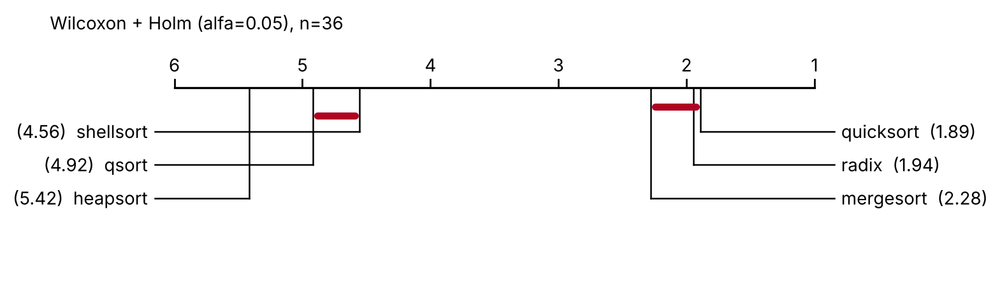
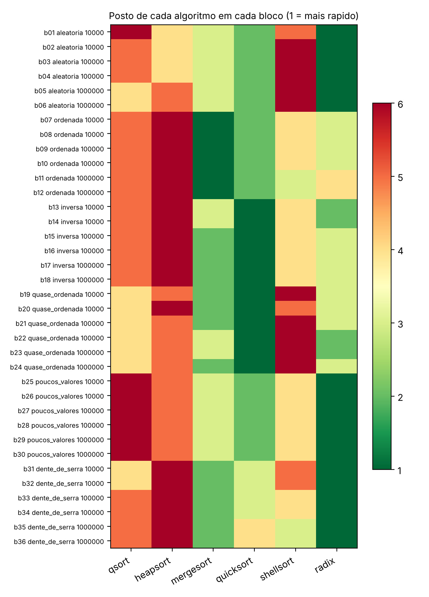

# Teste de Friedman na prática: comparando algoritmos de ordenação

Mini projeto do seminário de **IN1119 (Princípios e Técnicas da Análise Estatística Experimental), CIn/UFPE**.
A ideia é refazer, com um problema de computação leve, o tipo de comparação que o
artigo estudado no seminário faz com redes neurais: **k algoritmos medidos nos mesmos n blocos**.

- **C** mede o tempo de 6 algoritmos de ordenação em 36 entradas diferentes (`c/bench.c`)
  e traz o teste de Friedman (`c/friedman.c`).
- **Python** repete o teste, confere com o `scipy`, faz os testes post-hoc e desenha os diagramas (`python/friedman_analysis.py`).

## O problema

Qual algoritmo de ordenação é mais rápido? Depende da entrada. Por isso cada **bloco** é uma instância de entrada
(tipo de dado × tamanho × semente) e todos os algoritmos ordenam exatamente a mesma entrada dentro do bloco.

| | |
|---|---|
| **Tratamentos (k = 6)** | `qsort` (libc), `heapsort`, `mergesort`, `quicksort` (mediana de 3), `shellsort` (Ciura), `radix` (LSD, 8 bits) |
| **Blocos (n = 36)** | 6 tipos de entrada (aleatória, ordenada, inversa, quase ordenada, poucos valores, dente de serra) × 3 tamanhos (10⁴, 10⁵, 10⁶) × 2 sementes |
| **Medida** | mediana de 7 repetições, em ms (menor é melhor) |

Os postos são calculados dentro de cada bloco, então um tempo de 0,1 ms e um de 100 ms entram na análise
com o mesmo peso: o que conta é a ordem.

## Como rodar

Precisa de `gcc` (ou `clang`) e Python 3.9 ou mais novo. Logo após clonar o repositório, no Linux, macOS ou WSL:

```bash
cd friedman-sorting
pip install -r python/requirements.txt

make test # coompila e roda os testes (C e Python)
make mini      # exemplo pequeno dos slides: 3 algoritmos x 6 blocos, passo a passo
make rapido    # benchmark reduzido, poucos segundos
make run       # benchmark completo (cerca de 30 s) + Friedman em C + análise em Python
```

Sem `make`, os comandos são:

```bash
gcc -O2 -o c/bench c/bench.c
gcc -O2 -o c/friedman c/friedman.c -lm
./c/bench -o data/resultados.csv            # -q rápido, -r repetições, -s sementes
./c/friedman data/resultados.csv -v         # Friedman em C (-v mostra os postos de cada bloco)
python3 python/friedman_analysis.py data/resultados.csv --out saida
```

## O que sai

`data/resultados_exemplo.csv` é uma execução minha (Xeon de 2,1 GHz, gcc 13.3, `-O2`). **Os seus tempos serão outros.**
Compare as ordens, não os milissegundos.

```
Q = 136.8413  (gl = 5, C = 1.0000)  p = 8.39e-28
Iman-Davenport: F = 110.9728  gl = (5, 175)  p = 2.26e-52
W de Kendall = 0.7602

postos médios: quicksort 1.89 · radix 1.94 · mergesort 2.28 · shellsort 4.56 · qsort 4.92 · heapsort 5.42
Nemenyi (alfa = 0.05): CD = 1.257
```

| Diagrama (Wilcoxon + Holm) | Postos em cada bloco |
|---|---|
|  |  |

Para ver o teste com poucos números, que dá para fazer à mão:

```bash
python3 python/friedman_analysis.py data/resultados_exemplo.csv \
    --algos qsort heapsort mergesort --where tamanho=100000 semente=1 --verbose
```

Resultado: somas de postos 14, 16 e 6; Q = 9,33; p = 0,0094 pela qui-quadrado (p exato = 0,0055, calculado enumerando todas as 6^6 tabelas de postos). O Friedman rejeita H0, mas com n = 6 o
Wilcoxon com Holm não consegue apontar qual par difere (o menor p exato possível é 2/2⁶ = 0,031 e o Holm multiplica por 3).

## Usando com os seus dados

Um CSV com uma linha por bloco e uma coluna por tratamento. As 4 primeiras colunas são metadados
(`bloco,distribuicao,tamanho,semente`) e são ignoradas pelo C (`-m N` muda isso). Se maior é melhor
(acurácia, por exemplo), use `-H` no C e `--higher-is-better` no Python.

```
bloco,distribuicao,tamanho,semente,algoritmoA,algoritmoB,algoritmoC
...
```

## Passo a passo do que o código faz

1. **Postos dentro do bloco.** 1 para o melhor, k para o pior. Empate recebe o posto médio.
2. **Soma de postos** por algoritmo: R₁, …, R_k.
3. **Estatística:** `Q = 12/(n·k·(k+1)) · ΣRⱼ² − 3·n·(k+1)`, dividida pelo fator de correção de empates `C = 1 − Σ(t³−t)/(n·k·(k²−1))`.
4. **p-valor:** Q segue aproximadamente uma qui-quadrado com k−1 graus de liberdade sob H0. No C, a cauda da qui-quadrado sai da gama incompleta regularizada.
5. **Extras:** Iman-Davenport `F = (n−1)Q / (n(k−1) − Q)` com `F(k−1, (k−1)(n−1))`; W de Kendall `W = Q/(n(k−1))`.
6. **Post-hoc:** diferença crítica de Nemenyi `CD = q_α · √(k(k+1)/(6n))` e Wilcoxon pareado com correção de Holm.

## Limitações que vale conhecer

- **Os blocos não são uma amostra aleatória de "problemas de ordenação".** Eles vêm de uma grade escolhida por mim (6 tipos × 3 tamanhos × 2 sementes).
  O mapa de postos mostra que os blocos do mesmo tipo de entrada se parecem muito. O teste assume blocos independentes; aqui isso é uma aproximação.
- **As implementações são didáticas.** Detalhes como o atalho do `mergesort` para metades já ordenadas (ele ganha nas entradas ordenadas) mudam os postos.
  O `qsort` da libc varia entre versões de glibc, e em outros sistemas (musl, macOS, MSVC) o resultado muda.
- **Tempo de execução é ruidoso.** A mediana de 7 repetições ajuda, mas feche outros programas e não use bateria ao rodar.
- **A regra prática de Demšar** para a aproximação por qui-quadrado é n > 10 e k > 5. O exemplo de 3 algoritmos × 6 blocos está fora dela e serve só para ver as contas.

## Referências

- Friedman, M. (1937). The use of ranks to avoid the assumption of normality implicit in the analysis of variance. *JASA*, 32(200), 675–701.
- Friedman, M. (1940). A comparison of alternative tests of significance for the problem of m rankings. *Ann. Math. Statist.*, 11(1), 86–92.
- Demšar, J. (2006). Statistical comparisons of classifiers over multiple data sets. *JMLR*, 7, 1–30.
- Benavoli, A., Corani, G., Mangili, F. (2016). Should we really use post-hoc tests based on mean-ranks? *JMLR*, vol. 17.
- Ismail Fawaz, H. et al. (2019). Deep learning for time series classification: a review. *Data Mining and Knowledge Discovery*, 33, 917–963.

Licença: MIT.
